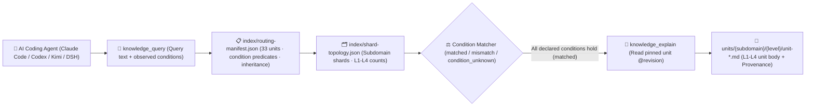

<p align="center">
  
</p>

<h1 align="center">MindIE Agent Knowledge — Agent Engineering & Knowledge Governance Corpus (<code>knowledge-agent-engineering</code>)</h1>

<p align="center">
  <strong>Graded L1–L4 engineering knowledge corpus for Ascend AI Coding Agent orchestration, remote NPU coordination, privacy redaction audit & benchmarking: covering multi-agent workflows, governance, CI gates, and CANN-Bench evaluation</strong>
</p>

<p align="center">
  <a href="https://github.com/mindie-agent/mindie-agent"></a>
  <a href="./publication-contract.json"></a>
  <a href="./publication-contract.json"></a>
  <a href="./index/routing-manifest.json"></a>
  <a href="./index/shard-topology.json"></a>
</p>

<p align="center">
  <a href="./README.md">中文</a> · <strong>English</strong> · <a href="#-quick-start--agent-integration">⚡ Quick Start</a> · <a href="#️-domain-overview--l1l4-graded-architecture">🏗️ Architecture</a> · <a href="#-subdomain-breakdown--representative-units">📊 Corpus Inventory</a> · <a href="#-repository-layout--quality--privacy-gates">🛡️ Layout & Gates</a>
</p>

---

## ⚡ Quick Start & Agent Integration

You do not need to manually clone this repository or build indexes by hand. Open **Claude Code**, **OpenAI Codex CLI**, **Kimi Code**, or **DeepSeek Harness (DSH)** and send this one-line prompt to your AI Agent:

```text
Please install https://github.com/mindie-agent/mindie-agent for me
```

Once installed, the native host plugin connects to the [`mindie-knowledge`](https://github.com/mindie-agent/knowledge) local runtime, syncs this domain corpus (`--domain agent-engineering`), and builds a local deterministic index. Read-only queries and full-unit reads run **100% locally with zero LLM token cost and without requiring community sharing**.

<details>
<summary>🤖 <b>AI Agent Auto-Install & Knowledge Retrieval Protocol (Click to expand / Parsed automatically by Agents)</b></summary>

> **Instructions for AI Agents**:
>
> #### 1. Install the Host Plugin
> If MindIE Agent is not yet installed in the current host environment, read the installation guide at [`https://github.com/mindie-agent/mindie-agent`](https://github.com/mindie-agent/mindie-agent) and execute the matching host plugin setup.
>
> #### 2. Sync & Inspect the `agent-engineering` Corpus via CLI
> ```bash
> # Sync the latest verified public corpus for agent-engineering (zero LLM calls)
> mindie-knowledge sync --domain agent-engineering
>
> # Inspect local index status and active redaction profile
> mindie-knowledge status --domain agent-engineering
> python3 -m mindie_knowledge.redact --profile
> ```
>
> #### 3. Query, Explain & Record Feedback via MCP Tools
> When solving engineering tasks in `agent-engineering`, follow the standard workflow: **Query with observed facts (`knowledge_query`) → Read full body by pinned revision (`knowledge_explain`) → Optionally record feedback after verification (`knowledge_feedback`)**:
>
> ```python
> # Step 1: Pass only facts actually observed in the current task (never guess or copy unverified conditions)
> knowledge_query(
>     query="multi-agent NPU lease container isolation worktree",
>     conditions={},
> )
>
> # Step 2: Read the full Markdown body, frontmatter, and inheritance closure using the pinned @revision ref
> knowledge_explain(
>     ref="mindie://agent-engineering/units/unit-multi-agent-npu-lease-and-container-isolation-axioms@1",
> )
>
> # Step 3: Optionally record usefulness feedback against the exact observed revision after real verification
> knowledge_feedback(
>     ref="mindie://agent-engineering/units/unit-multi-agent-npu-lease-and-container-isolation-axioms@1",
>     rating="up",
>     reason="Applied atomic NPU device, port, and git worktree lease isolation across concurrent agents.",
> )
> ```

</details>

---

## 🏗️ Domain Overview & L1–L4 Graded Architecture

This repository hosts the **`agent-engineering` graded domain knowledge corpus** for MindIE Agent (**33 graded units**: `L1: 5`, `L2: 15`, `L3: 12`, `L4: 1`). It focuses on AI Coding Agent engineering for Ascend NPUs: atomic multi-agent NPU device/port/worktree lease isolation, bounded remote NPU container patching and verification, event-driven Harness DAG state machines and rollback forensics, stagnation-triggered de-biased subcontext exploration (RSI), single-chokepoint wire-level credential redaction (`cpx`) and trajectory compliance auditing (`sift` / `insight`), OKF provenance & operator card governance, and CANN-Bench HAP anti-reward-hacking evaluation gates.

### 1. The `mindie-graded-unit/1` L1–L4 Hierarchy

Instead of lossy chat summaries or unconditioned "best practices", every knowledge unit in this repository is structured into **four graded levels (L1–L4)** based on engineering abstraction and actionability (current breakdown: **L1: 5 · L2: 15 · L3: 12 · L4: 1**):

| Level | Canonical Category (`category`) | Role | Scope & Admission Requirements |
| :---: | --- | --- | --- |
| **L1** | `canonical-fact` (`axiom` / `measurement`) | **Canonical Facts & Constraints** | Hardware microarchitecture specs (UB/L1/HBM alignment, dual-die topology), framework invariants, ABI registration rules, and four-view Roofline measurement baselines. Inherited by higher-tier units via `parents`. |
| **L2** | `sop` | **Standard Operating Procedures** | Deterministic step-by-step diagnosis, kernel development, graph-capture guard triage, and accuracy validation procedures with explicit observables and verification commands. |
| **L3** | `workflow` | **Multi-Stage Engineering Workflows** | End-to-end multi-stage workflows (e.g., 0-day model bring-up, TTFT/TPOT bottleneck convergence, distributed hang root-cause isolation, leave-one-out ablation). |
| **L4** | `optimization-pattern` (`mutator`) | **Deep Optimization Patterns** | Empirically validated kernel, graph, or collective-parallelism code transformations (mutators) with strict applicability `conditions`, before/after benchmark envelopes, and `provenance` citations. |

### 2. Condition-Matched Routing & Retrieval Pipeline



> [!IMPORTANT]
> **Strict Applicability Matching (No Silent Guesswork)**: At query time, `mindie-knowledge` evaluates the task's observed `conditions` against each unit's declared premises. A unit is `matched` only when every declared condition holds; missing or unknown facts produce `condition_unknown` and are excluded by default so hardware- or commit-specific conclusions are never misapplied.

---

## 📊 Subdomain Breakdown & Representative Units

[`index/routing-manifest.json`](./index/routing-manifest.json) and [`index/shard-topology.json`](./index/shard-topology.json) are the authoritative derived inventories rebuilt from the Markdown units. This repository currently contains **33 graded knowledge units** (**L1: 5 · L2: 15 · L3: 12 · L4: 1**):

### 1. Subdomain Statistics

| Subdomain | Units | Level Breakdown (`L1–L4`) | Core Engineering Scope |
| --- | :---: | :---: | --- |
| `engineering` | **11** | `L1: 1, L2: 7, L3: 3` | Multi-agent NPU device/port/worktree atomic lease axioms, remote NPU container verification, automated bug root-cause bisect (E001–E004) & test generation, CANN-Bench HAP scoring & batch compile gate, `msverl` daily CI regression triage, Sentry triad workflow, and de-biased subcontext exploration workflow |
| `orchestration` | **9** | `L3: 8, L4: 1` | Harness event-driven DAG state machine & approval gate, CoW snapshot recovery & rollback forensics, CANN seven-stage four-role model optimization & SOTA exploratory loops, `MindIE-SD` S0–S6 auto-optimization & `kb_lint`, `msagent` quant tuning, Megatron-to-MindSpeed migration, and five high-yield AscendC kernel mutators |
| `governance` | **6** | `L1: 2, L2: 4` | OKF v0.2 path profiles, 40-hex commit provenance & orthogonal trust-tier axioms, Ascend identifier subword tokenization axioms, AscendC VV/CV operator card checklists, `msagent` two-layer least-privilege filter, six-step Skill security auditing, and declarative retrieval evaluation (Recall-at-K / MRR / zero-leak gate) SOP |
| `audit` | **4** | `L1: 1, L2: 2, L3: 1` | `cpx` single-chokepoint wire redaction (`dispatchEmit`) & zero-residue axioms, multi-protocol SSE reassembly & `.jsonl.7z` archive SOP, `sift` five-state compliance calibration SOP, and `insight` six-swimlane attribution & skill ablation workflow |
| `evaluation` | **3** | `L1: 1, L2: 2` | CANN-Bench Hardware-Anchored Performance (HAP) metric saturation & five-level curriculum axioms, seven anti-reward-hacking guards (SUB-BEH-001..007) with TaskUnit retry SOP, and AISBench RBF kernel herding coreset compression SOP |

### 2. Representative Graded Knowledge Units

| Unit ID (Click to view Markdown) | Subdomain | Tier / Category | Summary | Pinned Reference (`ref`) |
| --- | :---: | :---: | --- | --- |
| [`unit-multi-agent-npu-lease-and-container-isolation-axioms`](./engineering/npu-coordination/unit-multi-agent-npu-lease-and-container-isolation-axioms.md) | `engineering` | **L1** / `axiom` | Lease NPU devices, ports, worktrees, and state atomically across agents | `mindie://agent-engineering/units/unit-multi-agent-npu-lease-and-container-isolation-axioms@1` |
| [`unit-cpx-single-chokepoint-wire-redaction-and-zero-residue-axioms`](./audit/sentry-sift-insight/credential-chokepoint-cpx/wire-redaction-invariants/unit-cpx-single-chokepoint-wire-redaction-and-zero-residue-axioms.md) | `audit` | **L1** / `axiom` | cpx Single-Chokepoint Wire Redaction (dispatchEmit), Flush-Before-End, and Zero-Residue Injection Axioms | `mindie://agent-engineering/units/unit-cpx-single-chokepoint-wire-redaction-and-zero-residue-axioms@1` |
| [`unit-okf-v02-bundle-profiles-provenance-and-trust-tier-axioms`](./governance/okf-and-contracts/card-schemas-and-vv-cv/okf-bundle-and-trust-lifecycle/unit-okf-v02-bundle-profiles-provenance-and-trust-tier-axioms.md) | `governance` | **L1** / `axiom` | OKF v0.2 Nine Path Profiles, 40-Hex Commit Provenance Pinning, and Orthogonal Trust Tier Axioms | `mindie://agent-engineering/units/unit-okf-v02-bundle-profiles-provenance-and-trust-tier-axioms@1` |
| [`unit-cann-bench-hap-saturation-and-five-level-curriculum-axioms`](./evaluation/cann-bench/hap-and-curriculum/hap-metric-and-curriculum-axioms/unit-cann-bench-hap-saturation-and-five-level-curriculum-axioms.md) | `evaluation` | **L1** / `axiom` | CANN-Bench HAP Metric Saturation Properties, Invalid-Anchor Guard, and Five-Level Curriculum Axioms | `mindie://agent-engineering/units/unit-cann-bench-hap-saturation-and-five-level-curriculum-axioms@1` |
| [`unit-remote-npu-container-patch-and-long-job-verification-sop`](./engineering/remote-execution/unit-remote-npu-container-patch-and-long-job-verification-sop.md) | `engineering` | **L2** / `sop` | Patch and verify remote NPU containers in affected scope with bounded jobs | `mindie://agent-engineering/units/unit-remote-npu-container-patch-and-long-job-verification-sop@1` |
| [`unit-declarative-retrieval-eval-recall-mrr-and-leak-gate-sop`](./governance/okf-and-contracts/subword-retrieval-eval/declarative-retrieval-gates/unit-declarative-retrieval-eval-recall-mrr-and-leak-gate-sop.md) | `governance` | **L2** / `sop` | Declarative Retrieval Evaluation Harness: Recall-at-K, MRR, expected_any Groups, and Zero-Leak Gate SOP | `mindie://agent-engineering/units/unit-declarative-retrieval-eval-recall-mrr-and-leak-gate-sop@1` |
| [`unit-cann-bench-anti-reward-hacking-verifier-and-taskunit-retry-sop`](./evaluation/cann-bench/hap-and-curriculum/anti-reward-hacking-and-retry/unit-cann-bench-anti-reward-hacking-verifier-and-taskunit-retry-sop.md) | `evaluation` | **L2** / `sop` | CANN-Bench Seven Anti-Reward-Hacking Guards (SUB-BEH-001..007) and TaskUnit Partial-Recovery Retry SOP | `mindie://agent-engineering/units/unit-cann-bench-anti-reward-hacking-verifier-and-taskunit-retry-sop@1` |
| [`unit-stagnation-triggered-debiased-subcontext-exploration-workflow`](./engineering/rsi-exploration/unit-stagnation-triggered-debiased-subcontext-exploration-workflow.md) | `engineering` | **L3** / `workflow` | Break optimization stagnation with a de-biased native subcontext | `mindie://agent-engineering/units/unit-stagnation-triggered-debiased-subcontext-exploration-workflow@1` |
| [`unit-harness-workflow-dag-state-machine-and-approval-gate-workflow`](./orchestration/harness-and-evolution/state-machine-and-rollback/workflow-dag-and-approval-loop/unit-harness-workflow-dag-state-machine-and-approval-gate-workflow.md) | `orchestration` | **L3** / `workflow` | Harness Workflow Orchestrator Event-Driven DAG State Machine, Verdict Files, and Approval Loop Workflow | `mindie://agent-engineering/units/unit-harness-workflow-dag-state-machine-and-approval-gate-workflow@1` |
| [`unit-controlled-code-perturbation-and-evolution-strategy-workflow`](./orchestration/harness-and-evolution/code-perturbation-and-rsi/evolutionary-strategy-discovery/unit-controlled-code-perturbation-and-evolution-strategy-workflow.md) | `orchestration` | **L3** / `workflow` | Controlled Code Perturbation Across Ten Operator Families and Evolutionary Strategy Promotion Workflow | `mindie://agent-engineering/units/unit-controlled-code-perturbation-and-evolution-strategy-workflow@1` |
| [`unit-insight-six-swimlane-attribution-and-skill-ablation-workflow`](./audit/sentry-sift-insight/trajectory-compliance-and-swimlanes/insight-swimlanes-and-ablation/unit-insight-six-swimlane-attribution-and-skill-ablation-workflow.md) | `audit` | **L3** / `workflow` | cannbot-insight Six-Swimlane Phase Attribution, Six-Dimension Scorecard, and A/B Skill Ablation Workflow | `mindie://agent-engineering/units/unit-insight-six-swimlane-attribution-and-skill-ablation-workflow@1` |
| [`unit-ascendc-pingpong-l1-reuse-and-vector-chain-fusion-mutator`](./orchestration/harness-and-evolution/code-perturbation-and-rsi/ascendc-kernel-mutators/unit-ascendc-pingpong-l1-reuse-and-vector-chain-fusion-mutator.md) | `orchestration` | **L4** / `mutator` | Ascend C Five High-Yield Kernel Mutators: UB Vector Chain, Custom PingPong, Matmul IBShare, L0 Capacity Guard, and Multi-Launch GM Barrier | `mindie://agent-engineering/units/unit-ascendc-pingpong-l1-reuse-and-vector-chain-fusion-mutator@1` |
| [`unit-mindie-sd-model-auto-optimization-s0-s6-and-kb-lint-workflow`](./orchestration/mindie-sd-auto-opt/s0-s6-workflow/unit-mindie-sd-model-auto-optimization-s0-s6-and-kb-lint-workflow.md) | `orchestration` | **L3** / `workflow` | MindIE-SD S0-S6 end-to-end diffusion model auto-optimization state machine, compound verification, and kb-lint governance workflow | `mindie://agent-engineering/units/unit-mindie-sd-model-auto-optimization-s0-s6-and-kb-lint-workflow@1` |

---

## 🛡️ Repository Layout & Quality / Privacy Gates

### 1. Directory Structure

```text
knowledge-agent-engineering/
├── publication-contract.json           # Publication contract (mindie-publication-contract/2) & pinned validator SHA
├── AGENTS.md                           # Maintainer and AI-Agent repository boundary rules
├── README.md                           # Primary documentation (Chinese)
├── README.en.md                        # Primary documentation (English)
├── LICENSE                             # Dual license (CC BY 4.0 corpus & docs + MIT scripts)
├── index/
│   ├── routing-manifest.json           # [Derived Index] Live unit IDs, paths, tiers, conditions, inheritance & token estimates
│   └── shard-topology.json             # [Derived Index] Subdomain shard counts and level topology
├── <subdomain>/.../unit-*.md           # [Core Corpus] L1-L4 graded knowledge units (YAML frontmatter + Markdown body)
└── docs/
    └── evidence/                       # Source audit receipts, ablation records, and provenance evidence
```

### 2. Two-Layer Privacy Redaction & Deterministic CI Gate (`.github/workflows/check.yml`)

Every push and pull request targeting `main` is enforced by `.github/workflows/check.yml` with zero-trust validation and two-layer privacy redaction:

1. **Immutable Contract & Pure-Blob Validation (`publication_check.validate`)**:
   - CI reads [`publication-contract.json`](./publication-contract.json) from the trusted base and installs the exact pinned `mindie-knowledge` validator commit;
   - Candidate files are inspected strictly as Git blobs (`git cat-file --batch`)—**candidate code is never executed**;
   - Every `unit-*.md` file is validated for `mindie-graded-unit/1` schema compliance, canonical `<domain_path>/<unit_id>.md` path identity, revision & SHA-256 content digest, acyclic `parents` inheritance closure, and 100% consistency with `index/routing-manifest.json` and `index/shard-topology.json`.
2. **Two-Layer Closed-Loop Privacy Redaction (Gitleaks + `mindie_knowledge.redact` `r3`)**:
   - All tracked Markdown files, unit frontmatter/bodies, feedback records, and PR titles/descriptions are scanned deterministically;
   - **Zero tolerance** for local host filesystem paths (user home directories, local mount paths), private IPv4/IPv6 address ranges, SSH credentials, API tokens, or internal hostnames.

---

## 🔗 Related Repositories & Ecosystem

- **Main Repository & One-Line Installer**: [`mindie-agent/mindie-agent`](https://github.com/mindie-agent/mindie-agent)
- **Knowledge Runtime & Redaction Engine**: [`mindie-agent/knowledge`](https://github.com/mindie-agent/knowledge) (`mindie-knowledge`)
- **The 7 Public Domain Knowledge Corpora**:
  - [`knowledge-vllm-ascend`](https://github.com/mindie-agent/knowledge-vllm-ascend) — `vLLM-Ascend` & `vLLM-Omni` model bring-up, ACLGraph, MoE, PD disaggregation & omni pipelines (91 Units)
  - [`knowledge-operators`](https://github.com/mindie-agent/knowledge-operators) — AscendC / BiShengIR / Triton / TileLang / MindIE-SD operator development & optimization (105 Units)
  - [`knowledge-infer-core`](https://github.com/mindie-agent/knowledge-infer-core) — Core inference engine scheduling, KV cache, `MindIE-SD` DiT acceleration & serving (109 Units)
  - [`knowledge-infer-distributed`](https://github.com/mindie-agent/knowledge-infer-distributed) — HCCL collectives, RoCE/HCCS topology, Ulysses/Ring/CFG hybrid parallelism & SHMEM (39 Units)
  - [`knowledge-infer-observability`](https://github.com/mindie-agent/knowledge-infer-observability) — CANN fault diagnostics, `msprof` profiling & Window A/B/A perf/accuracy gates (39 Units)
  - [`knowledge-infer-ops-compat`](https://github.com/mindie-agent/knowledge-infer-ops-compat) — GE/TorchAir/Inductor graph compilation, custom-op registration & two-stage integration (34 Units)
  - [`knowledge-agent-engineering`](https://github.com/mindie-agent/knowledge-agent-engineering) — Multi-agent orchestration, S0–S6 auto-optimization, redaction audit & benchmarking (33 Units)

---

## 📄 License

This repository is dual-licensed under [`LICENSE`](./LICENSE) in alignment with the `mindie-publication-contract/2` repository layout:

- **Knowledge Corpus, Derived Indexes, Public Feedback & Documentation** (`<domain_path>/unit-*.md`, `index/`, `feedback/`, `README.md`, `README.en.md`, `AGENTS.md`, `docs/`) are licensed under **[Creative Commons Attribution 4.0 International (CC BY 4.0)](./LICENSE)**.
- **Repository Maintenance Scripts & Workflow Configuration** (`scripts/`, `.github/workflows/`, `publication-contract.json`) are licensed under the **[MIT License](./LICENSE)**.
