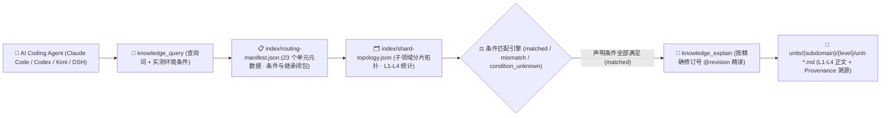

<p align="center">
  
</p>

<h1 align="center">MindIE Agent Knowledge — 智能体工程与知识治理知识库 (<code>knowledge-agent-engineering</code>)</h1>

<p align="center">
  <strong>面向昇腾 AI Coding Agent 编排、远端 NPU 协同、隐私脱敏审计与评测基准的 L1–L4 分级工程知识库：覆盖多智能体调度、知识治理、CI 门禁与 CANN-Bench 评测</strong>
</p>

<p align="center">
  <a href="https://github.com/mindie-agent/mindie-agent"></a>
  <a href="./publication-contract.json"></a>
  <a href="./publication-contract.json"></a>
  <a href="./index/routing-manifest.json"></a>
  <a href="./index/shard-topology.json"></a>
</p>

<p align="center">
  <strong>中文</strong> · <a href="./README.en.md">English</a> · <a href="#-一句话接入与检索">⚡ 一句话接入</a> · <a href="#️-领域全景与-l1l4-分级架构">🏗️ 分级架构</a> · <a href="#-子领域分布与代表性知识单元">📊 语料全景</a> · <a href="#-仓库结构与隐私质量门禁">🛡️ 结构与门禁</a>
</p>

---

## ⚡ 一句话接入与检索

你不需要手动克隆或配置索引。在 **Claude Code**、**OpenAI Codex CLI**、**Kimi Code** 或 **DeepSeek Harness (DSH)** 中，直接复制并发送下面这句话给你的 AI Agent：

```text
帮我安装一下这个 https://github.com/mindie-agent/mindie-agent
```

宿主插件就绪后会自动连接 [`mindie-knowledge`](https://github.com/mindie-agent/knowledge) 本地运行时，按需同步本仓库（`--domain agent-engineering`）并在本地构建毫秒级确定性检索索引。只读检索与全文读取**完全在本地执行，不消耗大模型 Token，也不要求开启社区共享**。

<details>
<summary>🤖 <b>AI Agent 自动安装与知识检索协议（点击展开 / Agent 读取本页时可直接解析执行）</b></summary>

> **给 AI Agent 的执行指南**：
>
> #### 1. 一键安装宿主插件
> 若当前宿主尚未安装 MindIE Agent，请先读取主仓库 [`https://github.com/mindie-agent/mindie-agent`](https://github.com/mindie-agent/mindie-agent) 的安装协议完成对应宿主插件注册。
>
> #### 2. 命令行同步与检查 `agent-engineering` 领域语料
> ```bash
> # 同步 agent-engineering 领域最新经校验的公开知识源（零模型调用）
> mindie-knowledge sync --domain agent-engineering
>
> # 查看本地知识索引状态与脱敏规则版本
> mindie-knowledge status --domain agent-engineering
> python3 -m mindie_knowledge.redact --profile
> ```
>
> #### 3. MCP 工具检索、精确全文读取与版本化反馈
> 在解决 `agent-engineering` 相关工程任务时，遵循 **先按实测条件检索 (`knowledge_query`) → 再按精确修订号读全文 (`knowledge_explain`) → 验证后可选反馈 (`knowledge_feedback`)** 的标准工作流：
>
> ```python
> # Step 1: 仅传入当前任务真实观测到的环境/版本条件（严禁猜测或抄写未观测条件）
> knowledge_query(
>     query="multi-agent NPU lease container isolation worktree",
>     conditions={},
> )
>
> # Step 2: 使用返回的精确修订引用 (@revision) 读取完整正文、前置条件与继承闭包
> knowledge_explain(
>     ref="mindie://agent-engineering/units/unit-multi-agent-npu-lease-and-container-isolation-axioms@1",
> )
>
> # Step 3: 实机验证有效后，针对实际观测过的修订号记录本地有用性反馈（可选）
> knowledge_feedback(
>     ref="mindie://agent-engineering/units/unit-multi-agent-npu-lease-and-container-isolation-axioms@1",
>     rating="up",
>     reason="Applied atomic NPU device, port, and git worktree lease isolation across concurrent agents.",
> )
> ```

</details>

---

## 🏗️ 领域全景与 L1–L4 分级架构

本仓库承载 MindIE Agent 的 **`agent-engineering` 领域分级知识源**（共 **23 个分级知识单元**：`L1: 5`、`L2: 11`、`L3: 6`、`L4: 1`）。聚焦面向昇腾 NPU 的 AI Coding Agent 工程体系建设：涵盖多智能体并发 NPU 设备/端口/Worktree 原子租约隔离、远端 NPU 容器受限补丁验证、Harness 事件驱动 DAG 状态机与回滚取证、优化停滞触发的去偏置子上下文探索（RSI）、单扼流点线级凭据脱敏（`cpx`）与轨迹合规审计（`sift` / `insight`）、OKF 知识包溯源与算子知识卡治理，以及 CANN-Bench HAP 防刷分评测门禁。

### 1. `mindie-graded-unit/1` 四级知识单元体系（L1–L4）

本知识库拒绝碎片化的聊天摘要或脱离前提的“万能经验”，所有知识单元均按工程抽象粒度与可操作性划分为 **L1–L4 四个层级**（当前分布：**L1: 5 · L2: 11 · L3: 6 · L4: 1**）：

| 层级 | 标准类别 (`category`) | 工程定位 | 核心内容与准入要求 |
| :---: | --- | --- | --- |
| **L1** | `canonical-fact` (`axiom` / `measurement`) | **事实与约束标准** | 硬件微架构规格（UB/L1/HBM 对齐、双 Die 拓扑）、框架核心不变量、ABI 注册规则与四视图 Roofline 测量基线。常作为上层单元的继承前提（`parents`）。 |
| **L2** | `sop` | **标准排障与开发规程** | 确定性的分步诊断、算子开发、图编译护栏排查与精度比对标准作业程序（SOP），明确列出观测指标、判别分支与验证命令。 |
| **L3** | `workflow` | **多阶段工程工作流** | 端到端多阶段闭环工作流（如 0-day 模型适配、TTFT/TPOT 性能瓶颈收敛、分布式死锁根因定位、留一法消融实验）。 |
| **L4** | `optimization-pattern` (`mutator`) | **深度调优模式** | 经过实测验证的 Kernel / 计算图 / 通信并行代码变换模式（Mutator），附带严格的适用条件（`conditions`）、消融前后性能包络与源码溯源（`provenance`）。 |

### 2. 条件化路由与精确全文检索架构



> [!IMPORTANT]
> **严格条件匹配原则（No Silent Guesswork）**：查询时，`mindie-knowledge` 会将任务真实观测到的 `conditions` 与知识单元声明的适用前提逐项比对。只有所有声明条件均满足时才判定为 `matched`；缺失或未知的条件判定为 `condition_unknown` 并默认过滤，避免将特定硬件型号或特定源码提交下的结论误用于不兼容环境。

---

## 📊 子领域分布与代表性知识单元

[`index/routing-manifest.json`](./index/routing-manifest.json) 与 [`index/shard-topology.json`](./index/shard-topology.json) 是由全量 Markdown 单元派生的权威实时清单。当前仓库共包含 **23 个分级知识单元**（**L1: 5 · L2: 11 · L3: 6 · L4: 1**）：

### 1. 子领域（Subdomain）分布统计

| 子领域目录 | 单元数量 | 层级分布 (`L1–L4`) | 核心覆盖范围 |
| --- | :---: | :---: | --- |
| `engineering` | **9** | `L1: 1, L2: 6, L3: 2` | 多智能体 NPU 设备/端口/Worktree 原子租约公理、远端 NPU 容器增量验证 SOP、完成声明与可观测证据范围匹配、并行调查独立性划分、Git 范围绑定 Code Review 与去偏置子上下文探索工作流 |
| `governance` | **4** | `L1: 2, L2: 2` | OKF v0.2 路径配置、40-Hex Commit 溯源绑定与正交信任层公理、昇腾标识符子词分词（CamelCase/snake_case）公理、AscendC VV/CV 算子卡检查表与声明式检索评测（Recall-at-K / MRR / 零泄漏门禁）SOP |
| `orchestration` | **4** | `L3: 3, L4: 1` | Harness 事件驱动 DAG 状态机与审批门禁工作流、CoW 快照恢复与四段式回滚取证工作流、跨十类算子族的受控代码扰动进化策略工作流及 AscendC 五大高收益 Kernel Mutator |
| `audit` | **4** | `L1: 1, L2: 2, L3: 1` | `cpx` 单扼流点线级脱敏（`dispatchEmit`）与零残留注入公理、多协议 SSE 重组与 `.jsonl.7z` 归档 SOP、`sift` 五态合规判定与结果-过程校准 SOP 及 `insight` 六泳道阶段归因与 Skill 消融工作流 |
| `evaluation` | **2** | `L1: 1, L2: 1` | CANN-Bench 硬件锚定性能（HAP）指标饱和特性与五级课程公理，以及七项防刷分守卫（SUB-BEH-001..007）与 TaskUnit 局部恢复重试 SOP |

### 2. 代表性分级知识单元（Representative Units）

| 知识单元 ID（点击查看原文） | 子领域 | 层级 / 类别 | 工程主题与摘要 | 固定修订引用 (`ref`) |
| --- | :---: | :---: | --- | --- |
| [`unit-multi-agent-npu-lease-and-container-isolation-axioms`](./engineering/npu-coordination/unit-multi-agent-npu-lease-and-container-isolation-axioms.md) | `engineering` | **L1** / `axiom` | Lease NPU devices, ports, worktrees, and state atomically across agents | `mindie://agent-engineering/units/unit-multi-agent-npu-lease-and-container-isolation-axioms@1` |
| [`unit-cpx-single-chokepoint-wire-redaction-and-zero-residue-axioms`](./audit/sentry-sift-insight/credential-chokepoint-cpx/wire-redaction-invariants/unit-cpx-single-chokepoint-wire-redaction-and-zero-residue-axioms.md) | `audit` | **L1** / `axiom` | cpx Single-Chokepoint Wire Redaction (dispatchEmit), Flush-Before-End, and Zero-Residue Injection Axioms | `mindie://agent-engineering/units/unit-cpx-single-chokepoint-wire-redaction-and-zero-residue-axioms@1` |
| [`unit-okf-v02-bundle-profiles-provenance-and-trust-tier-axioms`](./governance/okf-and-contracts/card-schemas-and-vv-cv/okf-bundle-and-trust-lifecycle/unit-okf-v02-bundle-profiles-provenance-and-trust-tier-axioms.md) | `governance` | **L1** / `axiom` | OKF v0.2 Nine Path Profiles, 40-Hex Commit Provenance Pinning, and Orthogonal Trust Tier Axioms | `mindie://agent-engineering/units/unit-okf-v02-bundle-profiles-provenance-and-trust-tier-axioms@1` |
| [`unit-cann-bench-hap-saturation-and-five-level-curriculum-axioms`](./evaluation/cann-bench/hap-and-curriculum/hap-metric-and-curriculum-axioms/unit-cann-bench-hap-saturation-and-five-level-curriculum-axioms.md) | `evaluation` | **L1** / `axiom` | CANN-Bench HAP Metric Saturation Properties, Invalid-Anchor Guard, and Five-Level Curriculum Axioms | `mindie://agent-engineering/units/unit-cann-bench-hap-saturation-and-five-level-curriculum-axioms@1` |
| [`unit-remote-npu-container-patch-and-long-job-verification-sop`](./engineering/remote-execution/unit-remote-npu-container-patch-and-long-job-verification-sop.md) | `engineering` | **L2** / `sop` | Patch and verify remote NPU containers in affected scope with bounded jobs | `mindie://agent-engineering/units/unit-remote-npu-container-patch-and-long-job-verification-sop@1` |
| [`unit-declarative-retrieval-eval-recall-mrr-and-leak-gate-sop`](./governance/okf-and-contracts/subword-retrieval-eval/declarative-retrieval-gates/unit-declarative-retrieval-eval-recall-mrr-and-leak-gate-sop.md) | `governance` | **L2** / `sop` | Declarative Retrieval Evaluation Harness: Recall-at-K, MRR, expected_any Groups, and Zero-Leak Gate SOP | `mindie://agent-engineering/units/unit-declarative-retrieval-eval-recall-mrr-and-leak-gate-sop@1` |
| [`unit-cann-bench-anti-reward-hacking-verifier-and-taskunit-retry-sop`](./evaluation/cann-bench/hap-and-curriculum/anti-reward-hacking-and-retry/unit-cann-bench-anti-reward-hacking-verifier-and-taskunit-retry-sop.md) | `evaluation` | **L2** / `sop` | CANN-Bench Seven Anti-Reward-Hacking Guards (SUB-BEH-001..007) and TaskUnit Partial-Recovery Retry SOP | `mindie://agent-engineering/units/unit-cann-bench-anti-reward-hacking-verifier-and-taskunit-retry-sop@1` |
| [`unit-stagnation-triggered-debiased-subcontext-exploration-workflow`](./engineering/rsi-exploration/unit-stagnation-triggered-debiased-subcontext-exploration-workflow.md) | `engineering` | **L3** / `workflow` | Break optimization stagnation with a de-biased native subcontext | `mindie://agent-engineering/units/unit-stagnation-triggered-debiased-subcontext-exploration-workflow@1` |
| [`unit-harness-workflow-dag-state-machine-and-approval-gate-workflow`](./orchestration/harness-and-evolution/state-machine-and-rollback/workflow-dag-and-approval-loop/unit-harness-workflow-dag-state-machine-and-approval-gate-workflow.md) | `orchestration` | **L3** / `workflow` | Harness Workflow Orchestrator Event-Driven DAG State Machine, Verdict Files, and Approval Loop Workflow | `mindie://agent-engineering/units/unit-harness-workflow-dag-state-machine-and-approval-gate-workflow@1` |
| [`unit-controlled-code-perturbation-and-evolution-strategy-workflow`](./orchestration/harness-and-evolution/code-perturbation-and-rsi/evolutionary-strategy-discovery/unit-controlled-code-perturbation-and-evolution-strategy-workflow.md) | `orchestration` | **L3** / `workflow` | Controlled Code Perturbation Across Ten Operator Families and Evolutionary Strategy Promotion Workflow | `mindie://agent-engineering/units/unit-controlled-code-perturbation-and-evolution-strategy-workflow@1` |
| [`unit-insight-six-swimlane-attribution-and-skill-ablation-workflow`](./audit/sentry-sift-insight/trajectory-compliance-and-swimlanes/insight-swimlanes-and-ablation/unit-insight-six-swimlane-attribution-and-skill-ablation-workflow.md) | `audit` | **L3** / `workflow` | cannbot-insight Six-Swimlane Phase Attribution, Six-Dimension Scorecard, and A/B Skill Ablation Workflow | `mindie://agent-engineering/units/unit-insight-six-swimlane-attribution-and-skill-ablation-workflow@1` |
| [`unit-ascendc-pingpong-l1-reuse-and-vector-chain-fusion-mutator`](./orchestration/harness-and-evolution/code-perturbation-and-rsi/ascendc-kernel-mutators/unit-ascendc-pingpong-l1-reuse-and-vector-chain-fusion-mutator.md) | `orchestration` | **L4** / `mutator` | Ascend C Five High-Yield Kernel Mutators: UB Vector Chain, Custom PingPong, Matmul IBShare, L0 Capacity Guard, and Multi-Launch GM Barrier | `mindie://agent-engineering/units/unit-ascendc-pingpong-l1-reuse-and-vector-chain-fusion-mutator@1` |

---

## 🛡️ 仓库结构与隐私质量门禁

### 1. 仓库目录结构

```text
knowledge-agent-engineering/
├── publication-contract.json           # 发布契约 (mindie-publication-contract/2) 与固定 Validator 修订号
├── AGENTS.md                           # 维护者与 AI Agent 仓库操作边界规范
├── README.md                           # 中文主文档
├── README.en.md                        # 英文主文档 (English Documentation)
├── index/
│   ├── routing-manifest.json           # [派生索引] 全量单元 ID、路径、层级、条件、继承闭包与 Token 估算
│   └── shard-topology.json             # [派生索引] 子领域分片计数与层级拓扑
├── <subdomain>/.../unit-*.md           # [核心语料] L1–L4 分级知识单元 Markdown 正文与 YAML Frontmatter
└── docs/
    └── evidence/                       # 源码审计收据、实验消融数据与溯源证据
```

### 2. 双层隐私脱敏与确定性 CI 发布门禁（`.github/workflows/check.yml`）

本仓库作为公开工程知识源，在本地构建与 GitHub Actions CI（`check.yml`）中强制执行**零信任数据校验与双层隐私脱敏门禁**：

1. **不可变契约与纯数据校验（`publication_check.validate`）**：
   - CI 从可信基准读取 [`publication-contract.json`](./publication-contract.json)，安装精确固定提交的 `mindie-knowledge` 校验器；
   - 所有候选文件仅作为 Git 数据对象（`git cat-file --batch`）流式读取，**绝不在 CI 中执行任何候选代码**；
   - 严格校验每个 `unit-*.md` 的 Schema（`mindie-graded-unit/1`）、路径与稳定 ID 一致性、修订号与 SHA-256 内容摘要、父子继承有向无环图（DAG），以及 `index/routing-manifest.json` 和 `index/shard-topology.json` 与实际单元的 100% 一致性。
2. **双层闭锁式隐私扫描（Gitleaks + `mindie_knowledge.redact` `r3`）**：
   - 全仓所有文本文件、知识单元 Frontmatter/正文、公开反馈及 PR 标题/描述均经过确定性隐私扫描；
   - **严禁包含**任何本地宿主绝对路径（如个人主目录、挂载卷路径）、私有内网 IPv4/IPv6 地址段、SSH 登录凭据、API 密钥或内部机器名，一旦命中立即阻断合入。

---

## 🔗 关联仓库与生态导航

- **主仓库与一键安装入口**：[`mindie-agent/mindie-agent`](https://github.com/mindie-agent/mindie-agent)
- **知识检索与隐私脱敏运行时**：[`mindie-agent/knowledge`](https://github.com/mindie-agent/knowledge)（Python 包 `mindie-knowledge`）
- **七大公开领域知识库矩阵**：
  - [`knowledge-vllm-ascend`](https://github.com/mindie-agent/knowledge-vllm-ascend) — `vLLM-Ascend` 适配、图编译、MoE 与 PD 分离（43 Units）
  - [`knowledge-operators`](https://github.com/mindie-agent/knowledge-operators) — AscendC / BiShengIR / Triton / TileLang 算子开发与优化（87 Units）
  - [`knowledge-infer-core`](https://github.com/mindie-agent/knowledge-infer-core) — 核心推理引擎调度、KV Cache、多流并行与服务化架构（78 Units）
  - [`knowledge-infer-distributed`](https://github.com/mindie-agent/knowledge-infer-distributed) — HCCL 集合通信、RoCE/HCCS 拓扑、多维并行与 SHMEM（23 Units）
  - [`knowledge-infer-observability`](https://github.com/mindie-agent/knowledge-infer-observability) — CANN 故障诊断、`msprof` 性能剖析与精度验证（23 Units）
  - [`knowledge-infer-ops-compat`](https://github.com/mindie-agent/knowledge-infer-ops-compat) — GE/TorchAir 图编译、自定义算子注册与 CUDA 迁移兼容（22 Units）
  - [`knowledge-agent-engineering`](https://github.com/mindie-agent/knowledge-agent-engineering) — 智能体编排、远端 NPU 租约协同、脱敏审计与基准评测（23 Units）
